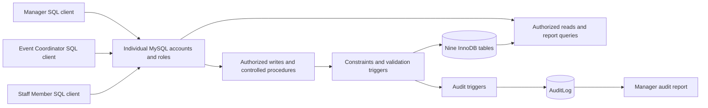
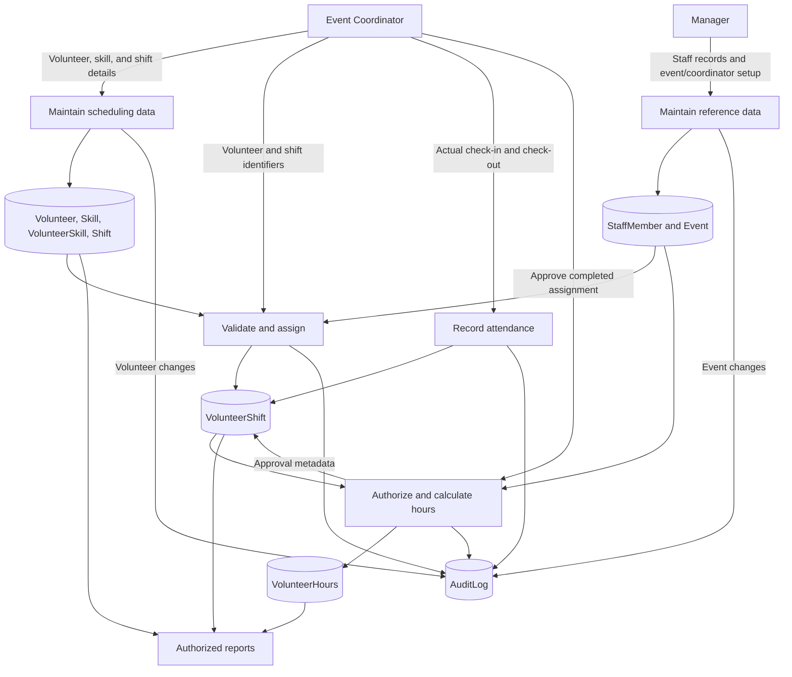
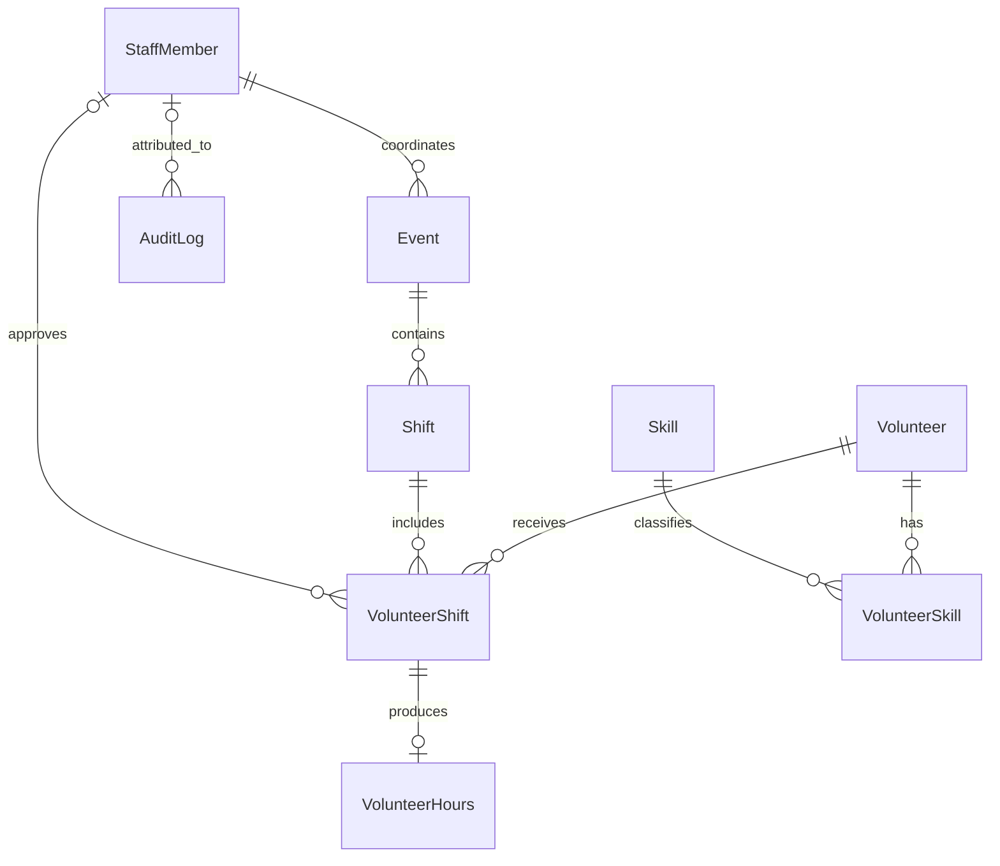
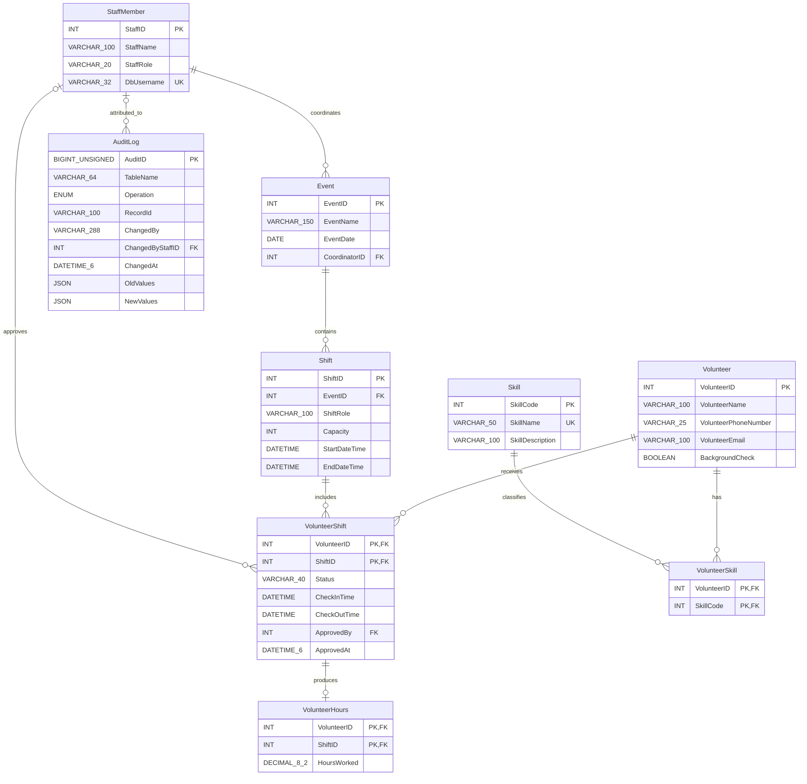

# Technical Design Document
## 1. Project Identification

| Item | Information |
|---|---|
| Project title | Volunteer and Community Service Management System |
| Prepared by | Christian Parra, Prabhas Penumatsa |
| Course | CS 437: Database Systems Implementation |
| Document version | 1.3 — MySQL 26.10.0 design baseline |
| Date | October 22, 2026 |
| Requirements baseline | Functional Requirements.md, version 1.1 |
| Status | Complete design draft; implementation and test verification pending |

This document specifies the intended database design. It does not certify that all described objects exist or that tests have passed. The repository currently contains an initial table script and a TDD outline. Section 14 identifies differences to reconcile before submission. The selected target is MySQL Community Server 26.10.0. This is a design choice, not a claim that the team has installed it. Runtime environment details and actual test results must be captured during verification. The public repository was rechecked at commit `94c7b1bc71fba8e0f16777c4a0308c995f1eb804`; it still contains the same initial SQL, with no newer implementation available on main.

## 2. Design Overview

The system provides a centralized relational database for a nonprofit organization to manage staff, volunteers, community events, shifts, volunteer skills, attendance, and approved service hours. Staff use individual database accounts. Volunteers are represented as records and do not log in.

The design contains nine related tables. Primary keys, foreign keys, unique constraints, and same-row checks enforce structural integrity. Triggers and controlled stored procedures enforce rules involving other records, maintain an audit trail, and approve hours atomically. Reports support volunteer contact, scheduling, attendance, approved-hours summaries, and management review.

Each event occurs on one calendar date and has one assigned Event Coordinator. A shift belongs to one event. A volunteer can participate in multiple non-overlapping shifts and have multiple skills. Approved hours are created only from a completed assignment by the event's assigned coordinator. Approved attendance cannot subsequently be corrected through this system.

## 3. Technical Environment

| Component | Design selection | Purpose / verification |
|---|---|---|
| DBMS | MySQL Community Server 26.10.0 (Innovation release) | Selected latest GA release as of October 22, 2026; supports the required database features; record `SELECT VERSION()` before testing |
| Storage engine | InnoDB for every table | Foreign-key enforcement, transactional changes, and row locking |
| Character set | utf8mb4 | Store names and descriptions without limiting text to ASCII |
| Client | Matching MySQL 26.10 command-line client; Workbench optional | Reference execution client for builds, reports, and separate user sessions; an IDE is optional and does not determine build correctness |
| Modeling | Mermaid for embedded relationship documentation; separate Chen diagram for final ER deliverable | Document relationships here and meet the assignment's conceptual ER notation separately |
| Source control | Existing GitHub repository | Version SQL, documents, diagrams, and reproducible build instructions |
| Operating environment | Portable local deployment; reference target Linux container with MySQL 26.10.0 | Host may be macOS, Windows, or Linux; container deployment is a selected reproducibility option, not an installed environment claim |
| Time convention | UTC for connection, audit, and approval timestamps; one configured event-local timezone for attendance DATETIME values | Set EVENT_TIME_ZONE before loading event fixtures; do not infer it from a developer’s location. Attendance comparisons use local wall-clock values without automatic conversion |

MySQL 26.10.0 is the latest GA release shown on the official download page on October 22, 2026, with release notes dated October 20, 2026. It is selected to satisfy the request for the most recent MySQL version. It is an Innovation release; ongoing upgrades would be part of any longer-lived deployment. The course project pins this version for reproducibility. An existing class server on another release must be verified separately rather than described as upgraded.

MySQL is selected because the FDD already specifies it and the required integrity, security, and transaction demonstrations can be implemented in the database. A single server is sufficient for the course workload. No ORM, web framework, or separate application server is required.

MySQL CHECK constraints are used for same-row validation; cross-table rules use procedures and triggers. Technical references are listed at the end of this document.

## 4. Architecture and Scope

### 4.1 System architecture



The client is the application integration boundary. A future application can call the same database interfaces using authenticated accounts; building that application is outside scope. Deployment credentials are separate from operational staff accounts.

### 4.2 Information flow



Audit triggers capture each audited insert/update; the flowchart groups those internal operations for readability. Skills and shifts are not audited under BR-29's minimum table list.

### 4.3 Scope and boundaries

Included: staff records and roles, event coordination, shifts, volunteer contact/background-check status, skills, assignments, attendance, approval, audit logging, SQL reports, schema build, and fictional initial data.

Excluded: public registration, mobile/web application development, automatic background-check expiration, multi-day/overnight shifts, correction of approved hours, and long-term community outcomes. Operational roles cannot delete records. Database administration and account provisioning are deployment activities.

## 5. Entity-Relationship Design

### 5.1 Relationships and participation

| Relationship | Cardinality and participation |
|---|---|
| StaffMember coordinates Event | A staff member coordinates 0..N events; each event has exactly 1 coordinator. Event participation is total; staff participation is partial. Assigned staff must have Event Coordinator role. |
| Event contains Shift | An event has 0..N shifts; each shift belongs to exactly 1 event. Shift participation is total. |
| Volunteer has VolunteerShift | A volunteer has 0..N assignments; each assignment has exactly 1 volunteer. Assignment participation is total. |
| Shift has VolunteerShift | A shift has 0..N assignments; each assignment has exactly 1 shift. Assignment participation is total. |
| VolunteerShift produces VolunteerHours | An assignment has 0..1 approved-hours record; each hours record belongs to exactly 1 assignment. Hours participation is total; assignment participation is partial. |
| StaffMember approves VolunteerShift | A staff member approves 0..N assignments; an assignment has 0..1 approver. Approval requires the assigned Event Coordinator. |
| Volunteer has VolunteerSkill | A volunteer has 0..N skill memberships; each membership belongs to exactly 1 volunteer. |
| Skill has VolunteerSkill | A skill has 0..N memberships; each membership references exactly 1 skill. |
| StaffMember is attributed AuditLog | A staff member is associated with 0..N audit entries; an audit entry has 0..1 mapped staff identity plus a required database-actor string. Deployment actors may have no StaffMember row. |

Volunteer–Shift and Volunteer–Skill are conceptual M:N relationships resolved through junction tables. Assignment–Hours is a conceptual 1:1 relationship with optional hours on the assignment side.

### 5.2 Relationship sketch



This relationship sketch supports the TDD. The final ER deliverable must additionally show all attributes, keys, relationship diamonds, total/partial participation, and the assignment's requested attribute-type notation.

### 5.3 Logical attribute diagram

This diagram lists every designed column and its SQL type/key role. Nullability and full constraints are specified in section 7. It is a logical schema diagram; the separate conceptual Chen diagram remains a distinct deliverable.



### 5.4 Weak entities and attribute types

VolunteerHours is existence- and identification-dependent on VolunteerShift. Its complete primary key is also a foreign key to that assignment. Show it as a weak entity with an identifying relationship in the conceptual diagram. VolunteerShift and VolunteerSkill are associative entities with composite keys.

Identifiers are key attributes. Total approved hours and remaining shift capacity are derived report attributes. HoursWorked is a stored, immutable derived value calculated at approval. A volunteer's collection of skills is a conceptual multivalued attribute represented relationally by VolunteerSkill. Names and phone numbers are treated as atomic text for this application's operations; there is no invented need to split names or store multiple contacts. Composite identifiers are identified explicitly; no composite contact attribute is required by the FDD.

## 6. Relational Schema

PK = primary key; FK = foreign key; UQ = unique key. All foreign keys use RESTRICT behavior for deletion and key updates. Identifier values are immutable.

```text
StaffMember(StaffID PK, StaffName, StaffRole, DbUsername UQ)
Event(EventID PK, EventName, EventDate, CoordinatorID FK -> StaffMember.StaffID)
Shift(ShiftID PK, EventID FK -> Event.EventID, ShiftRole, Capacity,
      StartDateTime, EndDateTime)
Volunteer(VolunteerID PK, VolunteerName, VolunteerPhoneNumber,
          VolunteerEmail, BackgroundCheck)
VolunteerShift(VolunteerID PK/FK -> Volunteer.VolunteerID,
               ShiftID PK/FK -> Shift.ShiftID, Status,
               CheckInTime, CheckOutTime,
               ApprovedBy FK -> StaffMember.StaffID, ApprovedAt)
VolunteerHours(VolunteerID PK, ShiftID PK, HoursWorked,
               FK (VolunteerID, ShiftID)
                   -> VolunteerShift(VolunteerID, ShiftID))
Skill(SkillCode PK, SkillName UQ, SkillDescription)
VolunteerSkill(VolunteerID PK/FK -> Volunteer.VolunteerID,
               SkillCode PK/FK -> Skill.SkillCode)
AuditLog(AuditID PK, TableName, Operation, RecordId,
         ChangedBy, ChangedByStaffID FK -> StaffMember.StaffID,
         ChangedAt, OldValues, NewValues)
```

Do not duplicate volunteer, event, or shift descriptive data in assignment or hours records. Joins retrieve those attributes. Audit snapshots intentionally preserve historical old/new values and are not the authoritative current records.

## 7. Table and Attribute Specifications

Unless marked nullable, columns are NOT NULL. Integer surrogate primary keys use AUTO_INCREMENT. Composite primary keys have no generated component. Text length limits are initial design choices to verify against sample data.

### 7.1 StaffMember

| Column | Type | Null/default | Key / meaning |
|---|---|---|---|
| StaffID | INT | Required; generated | PK |
| StaffName | VARCHAR(100) | Required | Staff display name |
| StaffRole | VARCHAR(20) | Required | CHECK: Manager, Event Coordinator, or Staff Member |
| DbUsername | VARCHAR(32) | Required | UQ; individual database username |

Operational usernames are unique across allowed account hosts; anonymous accounts and shared staff accounts are excluded. Use a case-sensitive comparison for identity mapping, matching the account provisioning convention. MySQL roles and StaffRole must agree; provisioning and role changes update both under administrator control.

### 7.2 Event

| Column | Type | Null/default | Key / meaning |
|---|---|---|---|
| EventID | INT | Required; generated | PK |
| EventName | VARCHAR(150) | Required | Event title |
| EventDate | DATE | Required | Single calendar date |
| CoordinatorID | INT | Required | FK to StaffMember; role validated |

### 7.3 Shift

| Column | Type | Null/default | Key / meaning |
|---|---|---|---|
| ShiftID | INT | Required; generated | PK |
| EventID | INT | Required | FK to Event |
| ShiftRole | VARCHAR(100) | Required | Work performed |
| Capacity | INT | Required | CHECK > 0 |
| StartDateTime | DATETIME | Required | Event-local start |
| EndDateTime | DATETIME | Required | CHECK > StartDateTime |

Both timestamp dates must equal EventDate. Overnight shifts are rejected.

### 7.4 Volunteer

| Column | Type | Null/default | Key / meaning |
|---|---|---|---|
| VolunteerID | INT | Required; generated | PK |
| VolunteerName | VARCHAR(100) | Required | Display/contact name |
| VolunteerPhoneNumber | VARCHAR(25) | Required | Text preserves leading zeros, plus signs, and formatting |
| VolunteerEmail | VARCHAR(100) | Required | Contact email; uniqueness is not required by the FDD |
| BackgroundCheck | BOOLEAN | Required; FALSE | CHECK IN (0,1); current verified flag |

No background-check documents, expiration dates, or sensitive background-check details are stored.

### 7.5 VolunteerShift

| Column | Type | Null/default | Key / meaning |
|---|---|---|---|
| VolunteerID | INT | Required | Composite PK; FK to Volunteer |
| ShiftID | INT | Required | Composite PK; FK to Shift |
| Status | VARCHAR(40) | Required; Scheduled | Allowed values below |
| CheckInTime | DATETIME | Nullable; NULL | Actual attendance start |
| CheckOutTime | DATETIME | Nullable; NULL | Actual attendance end |
| ApprovedBy | INT | Nullable; NULL | FK to StaffMember; procedure-managed |
| ApprovedAt | DATETIME(6) | Nullable; NULL | UTC approval time; procedure-managed |

There is no separately stored HoursApproved flag: approval is derived from ApprovedAt IS NOT NULL. ApprovedBy and ApprovedAt must both be NULL or both non-NULL; non-NULL approval requires Completed status.

| Status | CheckInTime | CheckOutTime |
|---|---|---|
| Scheduled | NULL | NULL |
| In-Progress | Required | NULL |
| Completed | Required | Required, later than check-in |
| No-Show | NULL | NULL |
| Cancelled | NULL | NULL |

A same-row CHECK explicitly enforces this matrix. Check-in must be at or after the shift start. The FDD does not require checkout to be no later than the scheduled end; no such additional restriction is assumed. A proposed normal workflow is Scheduled → In-Progress → Completed, Scheduled → No-Show, Scheduled → Cancelled, and Cancelled → Scheduled. Preapproval attendance corrections must still satisfy the status/time matrix and cancellation restrictions; the FDD does not impose an additional complete state-transition graph.

### 7.6 VolunteerHours

| Column | Type | Null/default | Key / meaning |
|---|---|---|---|
| VolunteerID | INT | Required | Composite PK; component of assignment FK |
| ShiftID | INT | Required | Composite PK; component of assignment FK |
| HoursWorked | DECIMAL(8,2) | Required | CHECK > 0; approval-time calculated hours |

The wider precision is a design adjustment from the starter SQL. Calculation: ROUND(TIMESTAMPDIFF(SECOND, CheckInTime, CheckOutTime) / 3600.0, 2). Because positive attendance shorter than the rounding threshold could become 0.00, ApproveHours rejects a rounded result <= 0 with a clear message. This is a proposed precision policy to reconcile with the FDD; it does not claim that every positive duration is representable to two decimals. No manual edits or duplicate approval records are permitted.

### 7.7 Skill

| Column | Type | Null/default | Key / meaning |
|---|---|---|---|
| SkillCode | INT | Required; generated | PK |
| SkillName | VARCHAR(50) | Required | UQ |
| SkillDescription | VARCHAR(100) | Required | Explanation of skill |

### 7.8 VolunteerSkill

| Column | Type | Null/default | Key / meaning |
|---|---|---|---|
| VolunteerID | INT | Required | Composite PK; FK to Volunteer |
| SkillCode | INT | Required | Composite PK; FK to Skill |

The pair is unique. Neither a volunteer nor a skill is required to have a membership. Deletes remain disallowed under the FDD; skill removal/deactivation is outside the current specification.

### 7.9 AuditLog

| Column | Type | Null/default | Key / meaning |
|---|---|---|---|
| AuditID | BIGINT UNSIGNED | Required; generated | PK; standardized from starter column Id |
| TableName | VARCHAR(64) | Required | Audited source table |
| Operation | ENUM('INSERT','UPDATE') | Required | DML operation |
| RecordId | VARCHAR(100) | Required | Source key; composite key serialized consistently |
| ChangedBy | VARCHAR(288) | Required | Full connected database actor string |
| ChangedByStaffID | INT | Nullable; NULL | FK to mapped StaffMember; NULL for deployment actor |
| ChangedAt | DATETIME(6) | Required; UTC assigned by trigger | Change timestamp |
| OldValues | JSON | Nullable | NULL for insert; before-image for update |
| NewValues | JSON | Required | After-image |

Composite RecordId values use stable field names, for example `VolunteerID=12;ShiftID=7`. TableName and RecordId identify different source tables and therefore do not form a single foreign key. Actor strings are retained even when no operational staff identity exists. Audit snapshots contain only the relevant table's fields; no account passwords or connection secrets are included.

## 8. Normalization Analysis

The operational relations satisfy 3NF under the following stated dependencies. Reports compute totals rather than storing running aggregates.

| Relation | Functional dependencies and normalization reasoning |
|---|---|
| StaffMember | StaffID → StaffName, StaffRole, DbUsername; DbUsername is another candidate key. No role description or repeated event list is stored. |
| Event | EventID → EventName, EventDate, CoordinatorID. Staff name/login remain in StaffMember, removing transitive staff details. |
| Shift | ShiftID → EventID, ShiftRole, Capacity, StartDateTime, EndDateTime. Event name/date are not copied into Shift. |
| Volunteer | VolunteerID → VolunteerName, VolunteerPhoneNumber, VolunteerEmail, BackgroundCheck. Skills are separate rows, not repeating columns. |
| VolunteerShift | (VolunteerID, ShiftID) → Status, CheckInTime, CheckOutTime, ApprovedBy, ApprovedAt. All non-key attributes describe the complete assignment, not either key component independently. Approver name is not duplicated. |
| VolunteerHours | (VolunteerID, ShiftID) → HoursWorked. There are no non-key determinants within this relation. This is an approval snapshot; cross-table consistency with attendance is maintained by atomic approval and immutability. |
| Skill | SkillCode → SkillName, SkillDescription; SkillName is an alternate candidate key. Description is not repeated in membership rows. |
| VolunteerSkill | Only the complete composite key is stored; no non-key attribute can introduce partial/transitive dependency. |
| AuditLog | AuditID → remaining columns. Actor and JSON snapshots are deliberate historical records; staff names are not maintained here as current staff master data. |

1NF: each operational column stores one value and memberships use separate rows. Audit JSON is an intentional history payload, not a substitute for normalized operational entities. 2NF: assignment-related facts depend on the entire composite key; single-key tables have no partial-key dependency. 3NF: descriptive staff, event, volunteer, and skill facts are stored in their own relations and accessed by keys.

Stored HoursWorked is deliberate derivation, not a claim that derivation alone violates 3NF. Its redundancy across tables requires the approval controls described below.

## 9. Integrity, Validation, and Business-Rule Enforcement

### 9.1 Enforcement matrix

Object names below are proposed logical names, not verified repository objects. Triggers can combine related checks on the same timing/event.

| FDD rule | Design enforcement |
|---|---|
| BR-01, BR-02 | Event and Volunteer primary keys |
| BR-03 | Shift.EventID NOT NULL FK |
| BR-04 | Event.CoordinatorID NOT NULL FK |
| BR-05 | Event BEFORE INSERT/UPDATE trigger checks coordinator role; controlled staff-role maintenance prevents invalidating existing assignments |
| BR-06 | StaffRole CHECK |
| BR-07 | Capacity and timestamp CHECK constraints |
| BR-08 | Shift BEFORE INSERT/UPDATE trigger checks EventDate; event-date edits restricted as below |
| BR-09, BR-10 | VolunteerShift composite PK and FKs |
| BR-11 | Assignment write procedure checks verified background status; trigger also rejects invalid activation |
| BR-12 | Serialized assignment procedure locks Shift, counts non-Cancelled assignments, and rejects capacity overflow |
| BR-13 | Serialized assignment procedure locks Volunteer and checks overlapping non-Cancelled assignments; reactivation repeats checks |
| BR-14 | Attendance fields exist only on VolunteerShift |
| BR-15, BR-16 | Status domain and status/time CHECK constraints |
| BR-17 | Assignment validation trigger compares CheckInTime with Shift.StartDateTime |
| BR-18 | CHECK: CheckOutTime IS NULL OR CheckInTime IS NULL OR CheckOutTime > CheckInTime; status matrix independently rejects incomplete Completed rows |
| BR-19 | No operational DELETE grants; BEFORE DELETE trigger rejects assignment deletion |
| BR-20 | BEFORE UPDATE trigger checks cancellation transitions; reactivation runs full eligibility/capacity/overlap validation |
| BR-21, BR-22 | ApproveHours validates identity, ownership, and completion; updates approval and inserts hours in one transaction |
| BR-23 | HoursWorked CHECK > 0 and procedure rounding validation |
| BR-24 | BEFORE UPDATE trigger rejects changes to approved assignment keys, status, attendance, and approval metadata; hours have no operational write grants |
| BR-25 | VolunteerSkill composite PK and FKs |
| BR-26 | StaffMember.DbUsername UNIQUE NOT NULL |
| BR-27 | Role grants, column restrictions, controlled routines, and account/StaffRole alignment |
| BR-28 | ApproveHours derives actor from connected user; no staff-ID argument |
| BR-29 | AFTER INSERT/UPDATE triggers on Volunteer, VolunteerShift, VolunteerHours, and Event insert AuditLog records |
| BR-30 | No operational AuditLog DML grants; BEFORE UPDATE/DELETE triggers reject mutation |

### 9.2 Concurrent scheduling

A count followed by an insert without serialization is insufficient. Assignment writes use a transaction-owning procedure such as SaveAssignment. Staff roles receive EXECUTE for permitted assignment actions instead of unrestricted INSERT/UPDATE on VolunteerShift. This implements the FDD's logical add/update entitlement through a controlled interface; it changes the suggested physical enforcement, not the business permission.

For a single assignment, the procedure locks the Volunteer row first and the Shift row second using SELECT ... FOR UPDATE. It then validates eligibility, capacity, overlap, cancellation transitions, and attendance before writing. Counts and overlap queries use current locking reads within that transaction, not an older consistent-read snapshot. All assignment mutation routes use this protocol, including cancellation, attendance changes, and approval where applicable. Keys cannot be changed to move an assignment; a different assignment must be created through the same procedure.

The Volunteer lock serializes competing schedules for the same person. The Shift lock serializes competing requests for the same capacity. Recheck conditions after waiting. The overlap predicate is new.StartDateTime < existing.EndDateTime AND new.EndDateTime > existing.StartDateTime. Cancelled rows and the assignment currently being updated are excluded. Back-to-back shifts are allowed. Use an indexed, supported locking query shape; validate the concrete SQL on the installed MySQL version.

Transactions are short. Deadlock or lock-timeout failures roll back and return a retryable error; clients retry the complete operation, not a partially completed statement. Two-session tests are required before describing concurrency protection as implemented.

### 9.3 Parent edits and historical consistency

Proposed conservative policy: once a shift has any assignment, reject changes to its EventID and scheduled start/end; a capacity reduction below its non-Cancelled assignment count is also rejected. Once an event has shifts, reject EventDate changes. These policies avoid retroactively invalidating attendance, overlaps, and date rules. They restrict some otherwise broad update permissions and must be acknowledged in final FDD reconciliation.

Shift maintenance locks the Shift row before checking dependent assignments. Assignment writes hold that same row lock. Event-date validation locks the relevant Event row; event maintenance serializes against shift creation. Reassigning an event coordinator is allowed through Manager event maintenance, serializes with approval on the Event row, and does not rewrite past approvals.

Changing a coordinator's staff role is rejected while they coordinate events. Administrative MySQL role changes and StaffRole edits must be coordinated. A background-check revocation prevents new/reactivated assignments; it does not erase historical attendance or approved hours. Volunteer maintenance serializes with assignment activation through the Volunteer row lock.

## 10. Database Objects and SQL Design

### 10.1 Stored procedures

| Proposed object | Interface and responsibility |
|---|---|
| SaveAssignment | Accepts assignment identifiers and permitted scheduling/attendance values; authenticates coordinator role; owns transaction; locks Volunteer then Shift; validates and writes assignment. Does not accept approval metadata. |
| ApproveHours | Accepts VolunteerID and ShiftID only; owns transaction; authorizes assigned coordinator; creates approved hours atomically. |
| Controlled maintenance routines | Implement any parent edits requiring coordinated locks, notably shift capacity/schedule, event date/coordinator, and staff role changes. Exact names may follow the final code. |
| Report SQL / read routines | Execute the ten reports with filters; enforce audit visibility through database privileges. |

Procedures reject calls from an already active caller-managed transaction, or use a separately documented compatible contract. The selected course implementation uses transaction-owning procedures called with no transaction already open; it must not silently commit unrelated caller work. Installation DDL is separate from these operational transactions.

### 10.2 ApproveHours algorithm

1. Resolve the connected username from USER() to exactly one StaffMember and require StaffRole = Event Coordinator. Preserve the full connection actor for audit. Do not substitute CURRENT_USER() inside a definer routine for the caller identity.
2. Begin a transaction; lock the Volunteer and Shift rows in the scheduling lock order, then lock the Event and VolunteerShift records needed for authorization and approval. Maintenance routines must use compatible ordering; test conflicting event/shift operations for deadlocks.
3. Require Event.CoordinatorID to equal the caller's StaffID, assignment Status = Completed, valid check-in/out, and NULL approval fields. Reject a missing assignment or an existing VolunteerHours row.
4. Calculate rounded hours using section 7.6. Reject an unrepresentable/nonpositive result.
5. Set ApprovedBy and ApprovedAt on VolunteerShift and insert the single VolunteerHours row. The auditing triggers write entries for both changes.
6. Commit only if all changes succeed. An EXIT handler for SQLEXCEPTION performs ROLLBACK and RESIGNAL. A duplicate/concurrent approval must result in one successful record and one rejection, never duplicate hours.

Approval fields are not writable by coordinator grants or SaveAssignment. A narrowly privileged SQL SECURITY DEFINER routine performs those writes. Do not use a caller-set session variable as an authorization bypass. Triggers enforce immutability after approval; routine privileges enforce who can set initial approval.

### 10.3 Trigger responsibilities

Validation triggers enforce coordinator role, shift date, attendance/time checks, cancellation rules, approved-record immutability, and delete protection. Concurrency-sensitive checks are performed in controlled procedures before DML so they can lock/read assignment data without relying on unsupported same-table trigger operations.

AFTER INSERT and AFTER UPDATE auditing triggers on the four specified tables insert AuditLog rows with connected actor, mapped staff identifier where available, source key, operation, UTC timestamp, and old/new JSON images. AuditLog itself has no auditing trigger that recursively audits its own inserts. Rejected or rolled-back writes leave no committed success audit entry. Capturing failed login/permission attempts would require separate server security logging and is outside this business audit mechanism.

The required “trigger making an update” demonstration is satisfied by a proposed BEFORE UPDATE attendance trigger that sets NEW.Status to In-Progress when check-in is first recorded and to Completed when checkout is recorded on an unapproved assignment. It must reject an explicitly contradictory requested status, then apply status/time checks. This mutates the incoming row using SET NEW.Status, rather than issuing a second UPDATE against the triggering table. The concrete implementation and instructor interpretation of this demonstration must be verified; audit-trigger INSERTs alone are not presented as an UPDATE demonstration.

### 10.4 Build and initial-data process

The final repository must provide an entry script and documented commands that obtain the repository and build a fresh schema with fictional initial data. Target order: create database/session settings; create parent and child tables; indexes; routines and triggers; seed staff/events/volunteers/shifts/skills/assignments; provision operational accounts and roles; run smoke checks. Seed audited data only after audit triggers exist, retaining the deployment actor when no staff mapping exists.

Privileged account provisioning is a separate, documented deployment step and uses local secrets. No password is committed. The build must stop on SQL errors; do not conceal errors with force/continue options. Document required working directory and paths. Keep reset/drop behavior explicit and limited to the project's test database. A fresh build is verified from a clean checkout, rather than assuming the existing developer database proves reproducibility.

### 10.5 Concrete deployment and build contract

The reference database is `volunteer_db`. Use InnoDB, utf8mb4 with a documented collation, strict SQL mode (including STRICT_TRANS_TABLES), session timezone `+00:00`, and READ COMMITTED for the controlled write interfaces. The session setting is applied to every operational connection; do not depend on a GUI connection's defaults. Locking reads, rather than isolation level alone, implement serialization. Event-local DATETIME values are supplied explicitly and are never interpreted as audit UTC values.

Recommended repository layout:

```text
build.sql
volunteer_DB/
  01_tables/tables.sql
  02_routines/routines.sql
  03_triggers/triggers.sql
  04_seed/sample_data.sql
  05_reports/reports.sql
  06_tests/acceptance.sql
  07_security/roles.sql
scripts/
  build.sh
  provision_accounts.sql.example
```

This is a proposed layout, not the current repository tree. Names can change, but build.sql must reference existing paths with exact case. The current file refers to `volunteer_db/01_tables/01_volunteers.sql`, which is absent; the tracked table file is `volunteer_DB/1. Tables/tables.sql`. Fix that mismatch before claiming the build works. Prefer paths without spaces and document the repository-root working directory. A reset that drops the database must be a separately named, explicit test-only operation; the ordinary build should fail if it would overwrite an existing populated schema.

Reference fresh-checkout invocation (requires the completed build files and configured MySQL login path):

```sh
git clone https://github.com/parraxc/Volunteer-and-Community-Service-Management-System.git
cd Volunteer-and-Community-Service-Management-System
mysql --login-path=volunteer-build --show-warnings < build.sql
```

The build account is an administrative deployment identity, not a Manager account. Credential setup uses a local login configuration or secret store, never a plaintext repository file. Operational accounts and the restricted routine definer are provisioned by deployment SQL after their required objects exist. Internal seed routines may be executed by the deployment account, but operational accounts must already have valid StaffMember mappings before their writes are tested.

Environment evidence query, run in each demonstration connection:

```sql
SELECT VERSION() AS ServerVersion,
       @@version_comment AS Distribution,
       @@session.sql_mode AS SqlMode,
       @@session.transaction_isolation AS IsolationLevel,
       @@session.time_zone AS SessionTimeZone,
       USER() AS ConnectedActor,
       CURRENT_USER() AS AuthenticatedAccount;
SHOW SESSION STATUS LIKE 'Ssl_cipher';
SHOW GRANTS;
```

A blank TLS cipher may be expected for a local Unix socket; it does not prove remote encryption. Record the connection method alongside the output. Maintain a versioned fixture timezone setting independent of the machine timezone. Actual outputs belong in test evidence, not fabricated into this document.

### 10.6 Indexing, performance, and growth

| Proposed index / existing key | Purpose |
|---|---|
| StaffMember(DbUsername) UNIQUE | Login mapping |
| Event(CoordinatorID, EventDate) | Coordinator/event filtering |
| Shift(EventID, StartDateTime) | Event shift lookups |
| VolunteerShift PK(VolunteerID, ShiftID) | Uniqueness and volunteer assignment lookup |
| VolunteerShift(ShiftID, Status, VolunteerID) | Capacity counting and rosters |
| VolunteerShift(Status, ApprovedAt, ShiftID) | Candidate index for pending approval; measure selectivity before keeping |
| VolunteerHours PK(VolunteerID, ShiftID), plus ShiftID index where needed | Volunteer totals and event joins |
| VolunteerSkill PK(VolunteerID, SkillCode), plus (SkillCode, VolunteerID) | Skill search in either direction |
| Volunteer(VolunteerName) | Directory sorting/search where optimizer benefits |
| AuditLog(TableName, RecordId, ChangedAt) | Record history |
| AuditLog(ChangedByStaffID, ChangedAt) | Staff audit review |

Review automatically created foreign-key indexes before adding redundant indexes. Use EXPLAIN and measured execution times for capacity, hours summary, skill search, and audit history queries. Indexes increase write/audit storage cost and are retained based on observed benefit.

| Workload | Design approach |
|---|---|
| Large batch writes | Bounded transactions through supported interfaces, parent-before-child loading, no constraint bypass; measure lock duration |
| Reads | Indexed joins, selective date/event filters, preaggregate hours before joining other one-to-many data |
| Updates | Lookup by indexed keys; hold locks only for validation/write; retain audit records |
| Deletes | Demonstrate operational denial; any future retention purge needs a separate design |
| High transaction volume | Test simultaneous signups and approvals, deadlock handling, and audit write overhead |
| Large extracts | Stream filtered results or use stable keyset pages; export an immutable dataset/snapshot when consistency is required |
| Growth | Monitor rows, query latency, database/audit size, and index usage; increase resources and tune queries before considering replication/partitioning |

Suggested nonbinding test scales are hundreds of fictional volunteers for correctness and larger generated datasets for query-plan comparison. No response-time or scalability result is claimed without measurements.

## 11. Query and Report Design

Report IDs follow the FDD's Reports and Queries table, whose RQ-04–RQ-09 acceptance labels currently differ. This is the canonical mapping for this document.

| ID / report | Inputs and SQL design | Result / edge case |
|---|---|---|
| RQ-01 Volunteer Directory | SELECT Volunteer; ORDER BY VolunteerName, VolunteerID | ID, name, phone, email, background status |
| RQ-02 Shift Roster | Optional ShiftID/EventID; join Event → Shift → VolunteerShift → Volunteer; Status <> Cancelled | Event/shift/role, volunteer, status; cancelled rows excluded |
| RQ-03 Shift Capacity | Event → Shift LEFT JOIN non-Cancelled assignments; GROUP BY shift attributes | Capacity, COUNT of matching assignment key, capacity minus count; empty shifts remain |
| RQ-04 Pending Hours Approval | Join Event, Shift, VolunteerShift, Volunteer; Completed and ApprovedAt IS NULL; filter coordinator | Attendance and calculated hours; approved assignment disappears after success |
| RQ-05 Volunteer Hours Summary | Aggregate VolunteerHours joined through Shift/Event with date filter inside aggregate; LEFT JOIN aggregate to Volunteer; COALESCE(total,0) | Every volunteer, including zero hours in selected range |
| RQ-06 Event Volunteer Hours | Event/Shift joined to approved hours; COUNT(DISTINCT VolunteerID), SUM(HoursWorked) | Volunteer counted once across multiple event shifts; hours from every approved shift included |
| RQ-07 Volunteer Skills Search | SkillCode filter; join Skill → VolunteerSkill → Volunteer | Matching volunteer, skill code, description |
| RQ-08 Background Check | Volunteer WHERE BackgroundCheck = FALSE | Only uncleared volunteers |
| RQ-09 Attendance | EventID/ShiftID filters; join Event, Shift, VolunteerShift, Volunteer; no status exclusion | Check-in/out and every status, including No-Show and Cancelled |
| RQ-10 Audit Log | Optional table/key/staff/date range; manager-only SELECT or report routine; ORDER BY ChangedAt DESC, AuditID DESC | Actor, timestamp, table/key, operation, old/new values |

Pending-hours coordinator filtering is a query parameter for discovery; ApproveHours always derives authorization independently. Global SELECT visibility for coordinators otherwise follows the FDD. Do not imply that report filters provide row-level access control.

Date ranges are inclusive for EventDate. Timestamp reports use a documented half-open interval [start, end) to avoid losing fractional seconds. All user-supplied values are bound parameters in future application integration; SQL demonstrations use clearly defined parameters.

Required SQL demonstrations include joins in the roster, UPDATE through attendance maintenance, aggregates in hours reports, a NOT EXISTS subquery identifying completed assignments with no VolunteerHours row, and procedure exception handling. The subquery report must agree with ApprovedAt-based pending results; a mismatch indicates an integrity defect.

## 12. Security, Privacy, and Backup Assumptions

### 12.1 Entitlements

V = view; A/U = authorized add/update, which may be exposed through controlled procedures; X = execute. No operational role receives DELETE, DDL, GRANT OPTION, or broad administrator privileges.

| Resource | Manager | Event Coordinator | Staff Member |
|---|---|---|---|
| StaffMember | V, A, U via controlled role maintenance where needed | None | None |
| Event | V, A, U | V | V |
| Shift | V | V, A, U | V |
| Volunteer, Skill, VolunteerSkill | V | V, A, U | V |
| VolunteerShift | V | V, A, U through controlled assignment interface | V |
| VolunteerHours | V | V; no direct writes | None |
| ApproveHours | None | X, own events only | None |
| AuditLog | V | None | None |

Approval metadata is excluded from user-writable columns. Where procedures are used, grant the corresponding logical action only through EXECUTE. Any definer routine uses a dedicated restricted owner, validates caller business role, exposes no arbitrary SQL, and is not owned by a root account for convenience. Report views/routines must not expose a source table forbidden by this matrix. In particular, Staff Member reports cannot disclose VolunteerHours through definer access.

The database schema owner remains technically capable of altering controls; audit immutability is an operational-role guarantee, not protection against a malicious database administrator.

### 12.2 Identity, encryption, and privacy

Provision one database login per staff member and map it to DbUsername. Restrict account host patterns and disallow username reuse across hosts for different people. USER() identifies the connected actor; record the full value in AuditLog and compare the username component case-sensitively to the provisioned staff mapping. Database role grants and stored StaffRole are separate controls and must be kept consistent.

Use only fictional volunteer/contact data for the course. Restrict database and backup files to authorized users. Require TLS with certificate verification for remote connections; record whether the class demonstration uses a local socket or verified TLS. At-rest protection relies initially on host/disk and backup encryption; native MySQL tablespace encryption is not asserted as configured. MySQL manages account authentication; application tables never store passwords.

### 12.3 Backup and recovery

Source control preserves schema and seed scripts, not live database state. Before major changes or submission, make a consistent logical backup of InnoDB data using an appropriate mysqldump invocation, including routines and triggers. Record the backup time, server version, and repository commit. Do not store credentials or contact-data backups in a public repository.

Restore to a separate empty test database, then verify row counts, procedure/trigger presence, role setup, and a sample hours report. MySQL user accounts/role grants require their own provisioning process and are not assumed to be included in an application schema dump. For the course, recovery means restoring a verified backup or rebuilding fictional initial data; production recovery objectives are outside scope.

## 13. Test Plan and Acceptance Criteria

### 13.1 Test data and execution

Use a Manager, two Event Coordinators, and a Staff Member with separate logins. Include verified/unverified volunteers; two events assigned to different coordinators; empty, full, overlapping, and back-to-back shifts; multiple skills; all five assignment statuses; completed but unapproved assignments; approved hours; and a volunteer with no hours. Use a reproducible fictional seed dataset and record each test's actual output, account, server version, and source commit.

The following are planned tests. No pass status is implied. Each test must leave known state or rebuild its fixture before rerunning.

| Test | Scenario | Expected result |
|---|---|---|
| T01 | Insert/view/update staff, events, volunteers, and shifts using entitled roles | Valid records persist; identifiers and references are correct |
| T02 | Duplicate PK/login/skill or nonexistent FK; invalid role/capacity/time/date/coordinator | Statement rejected; no invalid record committed |
| T03 | Duplicate volunteer/shift assignment | Second assignment rejected |
| T04 | Assign unverified volunteer, then verify and retry | First rejected; second accepted |
| T05 | Assign 12:00–15:00 then 14:00–17:00; retry with 15:00–17:00 | Overlap rejected; back-to-back accepted |
| T06 | Fill shift, attempt another assignment, cancel one, retry | Full shift rejected; cancellation releases capacity |
| T07 | Inconsistent status/times, early check-in, reversed checkout | Invalid attendance rejected; valid sequence accepted |
| T08 | Scheduled → Cancelled → Scheduled; Completed → Cancelled; reactivate on full/overlapping shift | Valid transitions succeed; invalid transitions/reactivation rejected |
| T09 | Add checkout to eligible checked-in assignment | BEFORE UPDATE trigger sets NEW.Status = Completed; matching audit entry committed |
| T10 | Assigned coordinator approves completed 12:00–15:00 assignment | One 3.00-hour row and matching approver/timestamp; both audit changes captured |
| T11 | Wrong coordinator, incomplete assignment, duplicate approval, or very short rounded-zero duration | Clear exception; no partial approval or hours row |
| T12 | Attempt direct approval-field writes, direct VolunteerHours insert/update, and postapproval attendance edits | Operational accounts denied or validation rejects; original approval unchanged |
| T13 | Staff Member reads then attempts write; coordinator edits Event; Manager calls ApproveHours | Reads permitted only as matrix allows; forbidden actions rejected |
| T14 | Change background status and approve hours; inspect audit; try audit UPDATE/DELETE | Correct old/new actor/time values; mutation rejected; only Manager can view |
| T15 | Begin transaction, change volunteer, inspect inside session, then ROLLBACK | Data and same-transaction audit inserts absent after rollback |
| T16 | Session A changes a record inside uncommitted transaction; deployment operator uses KILL CONNECTION from session B; reconnect | InnoDB rolls back uncommitted data and audit changes; unrelated committed data remains |
| T17 | Two sessions contend for last capacity slot, then for same volunteer's overlapping shifts | At most one conflicting operation commits; no capacity/overlap violation |
| T18 | Two sessions approve same assignment; race assignment against capacity edit and approval against coordinator reassignment | One approval only; final state satisfies serialized rules; no partial state |
| T19 | Execute RQ-01–RQ-10 under permitted accounts | Results match section 11, including empty shifts, zero-hour volunteers, distinct event counts, and every attendance status |
| T20 | Clean checkout/build, then backup/restore into separate test database | Schema/data/routines/triggers restored; deployment roles provisioned; smoke tests pass |
| T21 | Reject assignment DELETE; reject invalid parent edits and coordinator-role change | Records and dependencies remain valid |
| T22 | Measure representative queries with EXPLAIN and larger fictional data | Record plans and elapsed times; justify indexes from evidence |
| T23 | Volunteer with multiple skills and volunteer with two approved shifts at same event | Skill search accurate; event counts person once and sums both shifts |

For T16, issue KILL CONNECTION against the exact test session ID using a deployment account with appropriate authority. Do not use KILL QUERY alone as proof that the whole transaction was rolled back. Verification waits for rollback to finish. The operational roles do not receive session-management privileges.

### 13.2 Required demonstration coverage

| Assignment requirement | Evidence to capture |
|---|---|
| Transaction killed and rolled back | T16 before/after queries and test connection ID |
| Audit captures changes | T14 audit JSON and actor/time |
| Trigger makes an update | T09 incoming attendance row's status changed by trigger; confirm accepted interpretation |
| Constraint enforcement | T02, T03, T07 error and unchanged state |
| Joins, updates, subqueries, aggregates, exception handling | Roster join; attendance update; pending NOT EXISTS; hours aggregates; T11 procedure error |
| 3NF | Section 8 dependencies and schema comparison |
| Entitlements | T13 real-account permission attempts, including protected report sources |
| Performance | T17 contention results and T22 query plans/timings |

## 14. Requirement Traceability

### 14.1 Functional requirements

| Requirement | Design objects / sections | Tests |
|---|---|---|
| FR-01 | Event, coordinator validation; §§5–9 | T01, T02 |
| FR-02 | StaffMember and role maintenance; §§7,12 | T01, T02, T21 |
| FR-03 | Volunteer and audit; §§7,10 | T01, T04, T14 |
| FR-04 | Shift, Event FK, date/capacity/time validation | T01, T02, T21 |
| FR-05 | VolunteerShift, SaveAssignment, attendance trigger | T07–T09 |
| FR-06 | VolunteerHours assignment FK and reports | T10, T19 |
| FR-07 | Skill, VolunteerSkill, RQ-07 | T23 |
| FR-08 | VolunteerShift composite PK | T03 |
| FR-09 | Background activation check | T04 |
| FR-10 | Serialized overlap checks | T05, T08, T17 |
| FR-11 | Serialized capacity checks | T06, T08, T17 |
| FR-12 | ApproveHours completion validation | T10, T11 |
| FR-13 | Atomic hours insert and approval | T10, T11, T18 |
| FR-14 | Connected coordinator and Event ownership | T11, T18 |
| FR-15 | Role grants and controlled interfaces | T12, T13 |
| FR-16 | Four-table audit triggers and protected AuditLog | T14–T16 |

All BR-01–BR-30 are mapped in section 9.1. Every RQ-01–RQ-10 is specified in section 11 and verified under T19 with additional RQ-07/RQ-06 fixtures in T23. Performance, architecture, and security requirements are addressed in sections 4, 10.6, and 12.

### 14.2 Reconciliation before submission

| Item | Required action / current status |
|---|---|
| Installed environment | Target fixed to MySQL 26.10.0 and matching CLI; Linux container is the reference deployment; capture actual runtime output with section 10.5 queries |
| Starter SQL syntax | Correct AUTO_INCREMNET, mismatched Event_Coordinator/CoordinatorID and VolunterID names, trailing/missing commas, repeated CheckInTime in status check, and malformed OR expressions |
| Schema differences | Use required CoordinatorID; text phone; composite assignment FK for hours; remove HoursApproved; standardize AuditID; add staff audit mapping; choose documented precision/rounding |
| Controlled write interfaces | Implement assignment/approval and parent-maintenance locks; reconcile logical A/U entitlements with procedure EXECUTE grants |
| Proposed policy additions | Record acceptance of parent schedule/date restrictions and short-duration rounding policy; adjust FDD wording if retained |
| Report IDs | Align FDD acceptance labels: RQ-04 pending, RQ-05 volunteer summary, RQ-06 event hours, RQ-07 skills, RQ-08 background, RQ-09 attendance |
| Final conceptual ER deliverable | Produce full Chen diagram with requested notation; relationship sketch here is not the separate completed diagram |
| Runtime objects and results | Compare actual routine/trigger/index names to this design; fill test results only after execution |
| Build and evidence | Fix absent SOURCE path and case mismatch in current build.sql; implement the section 10.5 build contract, verify initial data, capture demos, and compare against final commit |

### 14.3 Current implementation versus designed objects

| Object area | Public main at 94c7b1b | Intended completion |
|---|---|---|
| Nine CREATE TABLE definitions | Present in initial table script; syntax/reference defects remain | Correct and reconcile to section 7 |
| Foreign keys and CHECKs | Partial definitions present; not executed here | Complete checks and assignment-level hours FK |
| Approval / scheduling procedures | No routine files present | Implement section 10 interfaces and handlers |
| Audit / validation triggers | No trigger files present | Implement section 9/10 controls |
| Roles / users | No security scripts present | Implement section 12 permissions and deployment provisioning |
| Sample data / reports / tests | No corresponding files present | Add fictional fixtures, ten reports, and test evidence |
| Build entry point | Present; drops schema and references an absent path | Make clean build reproducible and reset explicit |
| TDD | Public file is still an outline | This local version supplies completed design content |


### 14.4 Sources

- [Project FDD](https://github.com/parraxc/Volunteer-and-Community-Service-Management-System/blob/main/Functional%20Requirements.md), version 1.1, reviewed October 22, 2026.
- [Existing TDD outline](https://github.com/parraxc/Volunteer-and-Community-Service-Management-System/blob/main/Technical%20Design%20Document.md) and [initial SQL](https://github.com/parraxc/Volunteer-and-Community-Service-Management-System/blob/main/volunteer_DB/1.%20Tables/tables.sql), reviewed October 22, 2026.
- Instructor's supplied `database_group_project_requirements.pdf`: deliverables; architecture/security/performance; ER notation; 3NF; entitlements; demonstrations.
- [MySQL CHECK constraints](https://dev.mysql.com/doc/refman/26.10/en/create-table-check-constraints.html): same-row validation restrictions.
- [MySQL InnoDB locking reads](https://dev.mysql.com/doc/refman/26.10/en/innodb-locking-reads.html): transactional locking for competing operations.
- [MySQL stored object access control](https://dev.mysql.com/doc/refman/26.10/en/stored-objects-security.html): invoker/definer privilege context.
- [MySQL Community Server downloads](https://dev.mysql.com/downloads/mysql/): latest GA download verified as 26.10.0 on October 22, 2026.
- [MySQL 26.10 release notes](https://dev.mysql.com/doc/relnotes/mysql/26.10/en/): release dated October 20, 2026.
- [Repository source baseline](https://github.com/parraxc/Volunteer-and-Community-Service-Management-System/tree/94c7b1bc71fba8e0f16777c4a0308c995f1eb804): immutable source snapshot used for implementation-status comparison.
